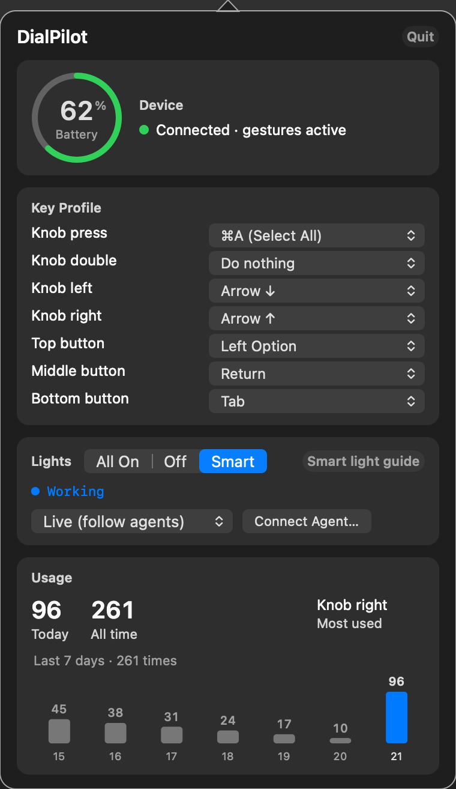
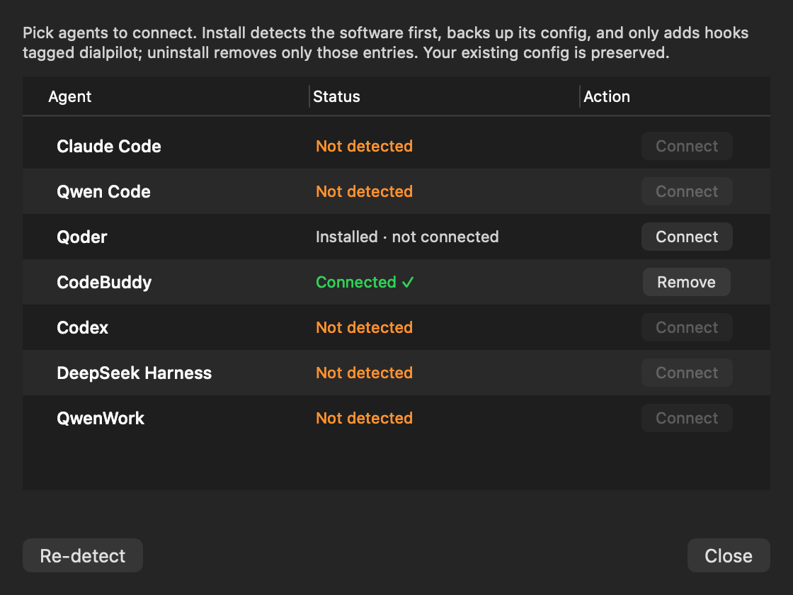

# DialPilot

**The macOS companion app for the Ulanzi AU05 (VibeKey) dial controller** — one dial, seven custom bindings, and coding-agent status on the device's LEDs. Device-bound, not a generic tool.

[](LICENSE)
[](https://www.apple.com/macos/)
[](https://support.apple.com/en-us/116943)
[](https://swift.org)
[](#install)
[](Package.swift)

[中文文档](README.zh.md)

> ⚠️ **Personal project — non-commercial intent.** This is a personal hobby project and is **not intended for commercial use**. The author provides no support, warranty, or licensing intent for commercial use. The code is released under MIT (to honor upstream fork obligations — see [LICENSE](LICENSE) and [NOTICE](NOTICE)), but the author explicitly states a non-commercial position; if you plan commercial use, assess legal and trademark risks yourself and contact upstream rights holders first. This software is unofficial and not affiliated with or endorsed by Ulanzi.

<p align="center">
  
</p>

## Screenshots

| Panel | Usage hover detail |
| --- | --- |
|  |  |

| Agent connections | Full-screen light guide |
| --- | --- |
|  |  |

## Supported device

| | |
| --- | --- |
| Manufacturer | **Ulanzi** (优篮子 / 乌兰子) |
| Model | **AU05**, marketed as **VibeKey** |
| Type | USB HID dial controller: rotary knob + 3 buttons + voice key, 4 indicator LEDs |
| USB identity | VID `0xFFF1`, PID `0x00DD` |
| Official host | Ulanzi Studio (not required by DialPilot; quit it before use) |

Search keywords: `Ulanzi AU05` · `VibeKey` · `优篮子 AU05` · `AU05 旋钮` · `VibeKey macOS` · `Ulanzi dial controller` · `coding agent status light`

## Features

- **One dial, seven bindings**: knob single-press, double-press, left/right rotation, and top/middle/bottom buttons are all customizable; record physical keyboard chords (up to 4 keys, left/right modifiers distinguished).
- **Agent status lights**: the knob is the agent's heartbeat, the middle key is the completion bell, middle+bottom fast blink means "come back and approve". Supports Claude Code / Qwen Code / Qoder / CodeBuddy (WorkBuddy) / Codex / DeepSeek Harness / QwenWork (enterprise edition).
- **Multi-session arbitration**: with several agents running, the LEDs show only the highest-priority state (approval > error > compaction > thinking > working > done > idle); sessions silent for 120 s are dropped. The panel shows which agent/session is on the LEDs and lists all active sessions on hover; `dialpilotctl status` prints the same detail.
- **Three light modes**: All On / Off (same as the device's native global modes) and Smart (agent-driven). A full-screen illustrated guide (←/→ or swipe, click/Esc to close) explains when each smart pattern lights up and what it looks like.
- **In-panel LED preview**: pick a state from a dropdown and see it on the device — no terminal needed.
- **Zero-maintenance device backup**: edit a binding and the AU05's offline six slots update automatically (debounced). No write button, no confirmation — the keys keep working after the app quits.
- **Bilingual UI**: English / 简体中文, follows the system language automatically.
- **Exception-only menu-bar badge**: the icon stays clean when everything is ready; a red dot means low battery, green means charging, orange means a permission is missing, and a faded dashed glyph means the device is gone or powered off. One badge at a time, fixed priority.
- **Survives menu-bar managers**: the panel is a window DialPilot positions itself, not an `NSPopover`. When Bartender/Ice moves or hides the icon, the panel follows the icon's live position (or closes if the icon is gone) instead of opening as a giant blank rectangle.
- **Honest connection state**: a switched-off AU05 stays enumerated on USB and ACKs heartbeats, so "device present" is not "device works". DialPilot treats an unanswered power query as silence and says *not responding* instead of showing a stale battery percentage.
- **Battery ring gauge**: the panel shows charge as a ring with a big number (green ≥50% / charging, yellow 20–49%, red <20%).
- **Local usage stats**: today / all-time counts, most-used control, and a 7-day bar chart with per-bar counts and hover detail (full date + that day's top control). Stored only in `~/Library/Application Support/DialPilot/usage.json` — no network, no identifiers beyond control names and days.
- Launch at login is on by default.
- Zero third-party dependencies, no network access (the QwenWork listener binds 127.0.0.1 loopback only), no vendor binaries included.

## Light semantics

| State | Pattern | Meaning |
| --- | --- | --- |
| idle / sleeping | all off | idle |
| thinking | knob slow blink 1.2 s | thinking |
| working | knob solid | working |
| attention | middle key lit 10 s, auto-off | turn complete |
| notification | middle+bottom fast blink 0.6 s | **needs your approval** (highest priority) |
| error | all LEDs flash 3×, then restore | error |
| sweeping | three-LED chase 0.5 s | context compaction |

The voice-key LED does not participate in status display (firmware key feedback — a flash on press/release is normal).

## Required permissions

DialPilot needs two macOS permissions for gestures and agent lights. **Without them the device's native six keys still work** — nothing breaks, you just lose double-press and LED control.

| Permission | Why it's needed | Where to grant |
| --- | --- | --- |
| **Input Monitoring** | Read the AU05's knob/button events over HID (the custom control interface) | System Settings → Privacy & Security → Input Monitoring → enable DialPilot |
| **Accessibility** | Send the configured keyboard actions (synthetic key events) to the frontmost app | System Settings → Privacy & Security → Accessibility → enable DialPilot |

- The app panel shows a **permission banner with one-click grant buttons** whenever either is missing; each button opens the exact Settings pane (and triggers the native prompt where macOS supports it).
- After granting, reopen the panel — status is re-checked every time it opens. Input Monitoring grants sometimes need an app restart to take effect; quit and relaunch DialPilot if gestures still don't start.
- **Signing decides whether a grant survives.** macOS ties a TCC grant to the app's *code signing requirement*, not to its bundle ID. The distributed build is ad-hoc signed, and an ad-hoc requirement is nothing but `cdhash H"…"` — a hash of the exact binary. So **every release is a new identity**: after an upgrade the old grant no longer matches, while System Settings still lists the app (the list is built from bundle IDs) and shows the switch as enabled. That combination — switch looks on, permission still missing — is this, not a bug in the app.
  **Fix:** System Settings → Privacy & Security → the permission → turn DialPilot **off and back on**, then relaunch. An already-on switch cannot be re-toggled, and off-then-on is what rewrites the stored requirement.
  Only a notarized Developer ID build keeps one stable requirement across versions, so upgrades stop asking. See [Troubleshooting](docs/user-guide.en.md#10-troubleshooting) for the one-liner that shows what macOS currently has on file.
- No other permissions are requested: no network access (the optional QwenWork listener binds 127.0.0.1 only), no camera/microphone, no files outside `~/Library/Application Support/DialPilot` and the agent config files you explicitly connect.

## Before first use (one-time, with Ulanzi Studio)

DialPilot talks to the device directly over HID and does **not** need Ulanzi Studio running. But for a brand-new AU05, do these once in the official app first:

1. **Install Ulanzi Studio** from Ulanzi's official site and connect the AU05 via USB.
2. **Upgrade the firmware** if Studio offers an update. DialPilot never touches firmware — it only writes the verified light-control group and the six key slots. Firmware updates must come from the official app.
3. **Confirm the device works natively**: knob rotation and the three buttons should produce their factory actions in Studio. This verifies the hardware and gives you a known-good baseline.
4. **Quit Ulanzi Studio completely** (⌘Q — closing the window is not enough; check the menu bar / Dock). From here on, keep it closed.

No account binding or key mapping in Studio is required for DialPilot — it writes its own six-slot backup automatically on first launch.

### Keep Ulanzi Studio closed

Two hosts cannot drive the AU05 at the same time. DialPilot handles this defensively:

- **At startup**: if Studio is running, DialPilot stays out of the device and tells you; the native six keys keep working.
- **During a device write**: if Studio is running, DialPilot quits it on your behalf (graceful first, force after 4 s) before writing, and warns if it survives both.
- **If Studio opens while DialPilot is running**: DialPilot immediately hands the device back to native mode and restores the light baseline; when Studio quits, DialPilot reconnects automatically.

Recommendation: remove Studio from login items so it never auto-starts alongside DialPilot.

## Install

**Homebrew — one command, no Gatekeeper dialog:**

```sh
brew install --cask lichengwu/tap/dialpilot
```

The cask pins the SHA-256 of the release image and clears the quarantine flag after installing, so the app opens on the first double-click and `brew upgrade` keeps it current.

**Script — if you don't use Homebrew:**

```sh
curl -fsSL https://raw.githubusercontent.com/lichengwu/dialpilot/main/scripts/install.sh | sh
```

It resolves the latest release, verifies the image against the published SHA-256, installs to `/Applications`, and clears quarantine.

**Disk image — the manual path:** download `DialPilot-<version>.dmg` from [Releases](https://github.com/lichengwu/dialpilot/releases/latest), open it, drag **DialPilot** onto the Applications shortcut. A browser download is quarantined, so Gatekeeper blocks the first launch. **Control-click → Open no longer works** — Apple removed that bypass in macOS 15 Sequoia, and macOS 26 behaves the same. Instead:

1. Double-click the app once, then dismiss the warning.
2. System Settings → Privacy & Security → scroll to the Security section → **Open Anyway**.
3. Authenticate; the warning returns with an Open button.

*Open Anyway* only stays for about an hour after the blocked launch — if it is gone, double-click the app again and go straight back. The terminal equivalent is `xattr -dr com.apple.quarantine /Applications/DialPilot.app`.

**Signing, stated plainly:** release images are **ad-hoc signed** — no Apple certificate, **not notarized**. That is deliberate. An Apple Development signature would not help a downloader (Gatekeeper rejects both) and would stop verifying when the certificate expires. Removing the dialog entirely needs a Developer ID certificate plus notarization, which requires a paid Apple Developer Program membership (¥688/year); this is a hobby project without one. The Homebrew and script channels sidestep the dialog because they fetch the file themselves instead of leaving a browser quarantine flag on it.

Then:
1. Quit Ulanzi Studio completely (two hosts fight over the device).
2. System Settings → Privacy & Security → allow **Input Monitoring** and **Accessibility**.
3. On first launch, an existing VibeKey Lite configuration is migrated automatically (if present).

Requires an Apple Silicon Mac on macOS 13+.

### Build from source

Requirements: Apple Silicon Mac, macOS 13+, Xcode Command Line Tools.

```sh
git clone https://github.com/lichengwu/dialpilot.git
cd dialpilot
swift test --disable-sandbox        # 271 tests should pass (Core 247 + App 24)
./build-app.sh                      # artifact: .build/app/DialPilot.app
./scripts/make-dmg.sh               # artifact: dist/DialPilot-<version>.dmg + .sha256
```

**Signing matters, and the two builds differ on purpose.** macOS ties Input Monitoring / Accessibility grants to the code signature, and an ad-hoc signature changes identity on every rebuild — which silently invalidates the permissions you just granted. So:

- `build-app.sh` (your local copy) picks your first **Apple Development** identity automatically, keeping those grants stable across rebuilds. Pin one with `DIALPILOT_SIGNING_IDENTITY="Apple Development: …"`.
- `make-dmg.sh` (what other people download) re-signs the *staged copy* **ad-hoc** and never touches `.build/app`. Ad-hoc cannot expire, so old releases keep working; a Developer ID identity can be substituted once one exists: `DIALPILOT_RELEASE_IDENTITY="Developer ID Application: …"`.

### Releasing

```sh
./scripts/release.sh 1.1.3 --dry-run   # print the plan, change nothing
./scripts/release.sh 1.1.3             # do it
```

Write the `## [1.1.3]` section in `CHANGELOG.md` first — the script refuses to
run without it and reuses that section verbatim as the release notes, so the
notes cannot drift from the changelog. It then bumps `CFBundleVersion`, runs the
test suite, builds and ad-hoc signs the DMG, pushes `main` + tag, publishes the
GitHub release with the `.dmg` and its `.sha256`, and finally writes the new
version and checksum into `../homebrew-tap`. A release is only finished when
`brew upgrade --cask dialpilot` on another machine picks it up.

`./scripts/update-cask.sh` is that last step on its own, for when you need it
separately.

## Usage

Click the menu-bar icon to open the panel:
- **Keys**: one dropdown per control — pick a preset action or "Record keyboard shortcut…". Changes save and sync to the device automatically.
- **Lights**: All On / Off / Smart mode selector, live state chip, preview dropdown, "Connect Agent…" button, and a guide button that opens the full-screen light explainer.
- **Usage**: today / all-time event counts, most-used control, 7-day chart. The card stays hidden until the first recorded event; hover a column for the full date, that day's count and its top control.
- **Quit**: the only maintenance button. Everything else (device backup, launch at login, gesture mode) is automatic.

The panel closes on Esc, a click anywhere outside, or ⌘-Tab; it repositions itself when the menu bar rearranges and closes rather than floats if the status item disappears.

### Connecting agent lights

"Connect Agent…" opens a list: each row shows detection status; **Connect** backs up the existing config and additively merges hooks tagged `dialpilot`; **Uninstall** removes only tagged entries — your own hooks stay untouched. **If the software is not detected you are prompted to install it first; nothing is written.**

CLI (inside the app bundle at `Contents/MacOS/dialpilotctl`):

```sh
dialpilotctl detect                          # per-agent install/connection status
dialpilotctl install-hooks --agent qoder     # claude-code|qwen-code|qoder|codebuddy|codex|dsh
dialpilotctl uninstall-hooks --agent qoder
dialpilotctl led --state working             # manual state (testing)
dialpilotctl led --restore                   # restore factory light baseline
dialpilotctl status                          # LED state + active sessions (winner marked *)
```

Notes: Codex requires `/hooks` approval inside a session before hooks fire; DSH needs a restart; QwenWork supports hooks only in the enterprise premium edition (HTTP hooks — copy the config from the app into the enterprise console).

## Acceptance

```sh
./scripts/acceptance.sh offline   # offline: all automatic assertions (mock device)
./scripts/acceptance.sh live      # on-device: hold each state + pause at manual checks
```

## Architecture

```
Agent hooks → dialpilotctl → Unix socket → DialPilot app (the only HID writer)
                                              ├─ DialLedSessionAggregator (multi-session arbitration)
                                              ├─ DialLedRenderEngine (pure render state machine, injected-clock testable)
                                              └─ LedRenderer thin shell (timers + HID write plumbing)
```

- `DialPilotCore`: pure logic, no AppKit/IOKit — protocol codec, LED engine, installers, arbitration, liveness, usage stats, localization; fully unit-testable.
- `DialPilotApp`: menu-bar app; HID transport and UI. The panel is a borderless `NSPanel` owned by `DialPanelController`; window geometry is a pure function (`DialPanelGeometry`) covered by unit tests, so the size/position bugs `NSPopover` produced cannot come back.
- `dialpilotctl`: hook CLI; sends commands only, never touches HID (single-writer discipline).

Hard-won pitfalls are documented in the corresponding source headers (`DialLedControl.swift`, `DialPacketCodec.swift`, `DialHookInstaller.swift`, `DialPanelController.swift`, …).

## Documentation

| Document | Language | What it covers |
| --- | --- | --- |
| [User guide](docs/user-guide.en.md) | English | Install, panel anatomy, permissions, agent hooks, troubleshooting |
| [用户指南](docs/user-guide.md) | 中文 | 同上（中文版为维护主版本） |
| [Protocol notes](docs/protocol.md) | 中文 | HID report layout, verified command groups, confidence labels |
| [Light design](docs/led-design.md) | 中文 | State → pattern rules (R1–R7) and arbitration |
| [Changelog](CHANGELOG.md) | English | Release notes (Keep a Changelog) |

## Origins & acknowledgments

DialPilot stands on the shoulders of:

- **[arumwu/vibekey-lite](https://github.com/arumwu/vibekey-lite)** (MIT) — the direct predecessor. Forked, then extended with reliability merges and the full agent-light pipeline, and finally restructured into DialPilot. Thanks to the original author for open-sourcing the lightweight AU05 configurator foundation.
- **The `ustudio-cli` hook sources shipped with Ulanzi Studio 3.3.6** (plaintext JS distributed with the official app) — the agent event→state mapping table (9 agents) directly references its `mappings.js`; the installer contract (settings.json hook groups, stdin JSON) was cross-checked against it. Thanks to Ulanzi for shipping this part as readable plaintext.
- **The Ulanzi AU05 / VibeKey hardware** — protocol facts come from HID descriptor reads on a real AU05, read-only static analysis of the Ulanzi Studio 3.3.6 `UlanziDeck` executable, and controlled on-device read/write tests. **This project does not contain, copy, load, link, or redistribute `kwdm.dylib`, `UlanziDeck`, or any vendor binary**; reverse engineering was solely for interoperability. Per-fact conclusions with confidence labels: [docs/protocol.md](docs/protocol.md).
- Public hooks documentation of the coding agents (Claude Code, Qwen Code, Qoder, Codex, DeepSeek Harness, QwenWork) — installers follow each vendor's public contract.

What DialPilot adds over its predecessor: full four-LED frame construction with range validation, an injected-clock pure render engine (all R1–R7 rules unit-tested), multi-session priority arbitration, one-click install/uninstall for seven agents (backup + additive merge + tagged uninstall), the QwenWork loopback HTTP listener, a zero-maintenance single-profile panel (auto device backup, full-screen light guide, bilingual UI, exception-only menu-bar badge, battery ring gauge, local usage stats, a self-positioning panel that survives menu-bar managers), and 271 tests (Core 247 + App 24).

## License & disclaimer

- Code: [MIT](LICENSE). Upstream copyright retained in [NOTICE](NOTICE).
- **Personal project, non-commercial intent** (see the notice at the top).
- Independent unofficial implementation, not affiliated with Ulanzi; no firmware-compatibility guarantee — device writes are at your own risk (brick-prevention discipline: only verified command groups, range validation, GET read-back, baseline restore on exit).