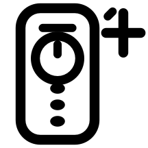
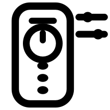

# DialPilot

**The macOS companion app for the Ulanzi AU05 (VibeKey) dial controller** — auto-switch key profiles by frontmost app, and show coding-agent status on the device's LEDs. Device-bound, not a generic tool.

[中文文档](README.zh.md)

> ⚠️ **Personal project — non-commercial intent.** This is a personal hobby project and is **not intended for commercial use**. The author provides no support, warranty, or licensing intent for commercial use. The code is released under MIT (to honor upstream fork obligations — see [LICENSE](LICENSE) and [NOTICE](NOTICE)), but the author explicitly states a non-commercial position; if you plan commercial use, assess legal and trademark risks yourself and contact upstream rights holders first. This software is unofficial and not affiliated with or endorsed by Ulanzi.

<p align="center">
  
  
</p>

## Supported device

| | |
| --- | --- |
| Manufacturer | **Ulanzi** (优篮子 / 乌兰子) |
| Model | **AU05**, marketed as **VibeKey** |
| Type | USB HID dial controller: rotary knob + 3 buttons + voice key, 4 indicator LEDs |
| USB identity | VID `0xFFF1`, PID `0x00DD` |
| Official host | Ulanzi Studio (not required by DialPilot; quit it before use) |

Search keywords: `Ulanzi AU05` · `VibeKey` · `优篮子 AU05` · `AU05 旋钮` · `VibeKey macOS` · `Ulanzi dial controller` · `coding agent status light`

## Features

- **Two full six-control profiles** (AI / System): knob single-press, double-press, left/right rotation, and top/middle/bottom buttons are all customizable; record physical keyboard chords (up to 4 keys, left/right modifiers distinguished).
- **Auto profile switching by frontmost app**: configure `appProfileMapping` (bundleID → profile) in config.json; 200 ms debounce; unmapped apps keep the current profile.
- **Agent status lights**: the knob is the agent's heartbeat, the middle key is the completion bell, middle+bottom fast blink means "come back and approve". Supports Claude Code / Qwen Code / Qoder / CodeBuddy (WorkBuddy) / Codex / DeepSeek Harness / QwenWork (enterprise edition).
- **Multi-session arbitration**: with several agents running, the LEDs show only the highest-priority state (approval > error > compaction > thinking > working > done > idle); sessions silent for 120 s are dropped.
- **In-panel LED preview**: pick a state from a dropdown and see it on the device — no terminal needed.
- Battery / charging / standby / power-off times shown read-only; only **Write to Device** updates the on-device six slots — normal profile switching never writes the device.
- Zero third-party dependencies, no network access (the QwenWork listener binds 127.0.0.1 loopback only), no vendor binaries included.

## Light semantics

| State | Pattern | Meaning |
| --- | --- | --- |
| idle / sleeping | all off | idle |
| thinking | knob slow blink 1.2 s | thinking |
| working | knob solid | working |
| attention | middle key lit 10 s, auto-off | turn complete |
| notification | middle+bottom fast blink 0.6 s | **needs your approval** (highest priority) |
| error | all LEDs flash 3×, then restore | error |
| sweeping | three-LED chase 0.5 s | context compaction |

The voice-key LED does not participate in status display (firmware key feedback — a flash on press/release is normal).

## Install

Requirements: Apple Silicon Mac, macOS 13+, Xcode Command Line Tools.

```sh
git clone https://github.com/lichengwu/dialpilot.git
cd dialpilot
swift test --disable-sandbox        # 224 tests should pass (Core 219 + App 5)
./build-app.sh                      # artifact: .build/app/DialPilot.app
```

**Signing matters**: the default ad-hoc signature invalidates macOS Input Monitoring / Accessibility grants on every rebuild. Use one valid development identity consistently:

```sh
DIALPILOT_SIGNING_IDENTITY="Apple Development: Your Name (TEAMID)" ./build-app.sh
```

Then:
1. Quit Ulanzi Studio completely (two hosts fight over the device).
2. Copy `DialPilot.app` to `/Applications/` and launch it.
3. System Settings → Privacy & Security → allow **Input Monitoring** and **Accessibility**.
4. On first launch, an existing VibeKey Lite configuration is migrated automatically (if present).

## Usage

Click the menu-bar icon to open the panel:
- **Profiles**: AI / System switch; one dropdown per control — pick a preset action or "Record keyboard shortcut…".
- **Status lights**: live state chip + preview dropdown + "Connect Agent…" button.
- **Write to Device**: writes the current profile's six single-press actions into the AU05's offline storage (the device uses that profile after the app quits).
- **Native / Gesture mode**: native = device uses its stored six keys directly; gesture = the app takes over, enabling double-press / long-press.

### Connecting agent lights

"Connect Agent…" opens a list: each row shows detection status; **Connect** backs up the existing config and additively merges hooks tagged `dialpilot`; **Uninstall** removes only tagged entries — your own hooks stay untouched. **If the software is not detected you are prompted to install it first; nothing is written.**

CLI (inside the app bundle at `Contents/MacOS/dialpilotctl`):

```sh
dialpilotctl detect                          # per-agent install/connection status
dialpilotctl install-hooks --agent qoder     # claude-code|qwen-code|qoder|codebuddy|codex|dsh
dialpilotctl uninstall-hooks --agent qoder
dialpilotctl led --state working             # manual state (testing)
dialpilotctl led --restore                   # restore factory light baseline
dialpilotctl status
```

Notes: Codex requires `/hooks` approval inside a session before hooks fire; DSH needs a restart; QwenWork supports hooks only in the enterprise premium edition (HTTP hooks — copy the config from the app into the enterprise console).

### Auto profile switching

`~/Library/Application Support/DialPilot/config.json`:

```json
{
  "appProfileMapping": {
    "com.apple.Terminal": "a",
    "com.microsoft.VSCode": "a"
  }
}
```

`"a"` = AI profile, `"b"` = System profile; unmapped apps keep the current profile. Find a bundleID: `mdls -name kMDItemCFBundleIdentifier -raw /Applications/SomeApp.app`. Full field reference: [docs/user-guide.md](docs/user-guide.md) (Chinese).

## Acceptance

```sh
./scripts/acceptance.sh offline   # offline: all automatic assertions (mock device)
./scripts/acceptance.sh live      # on-device: hold each state + pause at manual checks
```

## Architecture

```
Agent hooks → dialpilotctl → Unix socket → DialPilot app (the only HID writer)
                                              ├─ DialLedSessionAggregator (multi-session arbitration)
                                              ├─ DialLedRenderEngine (pure render state machine, injected-clock testable)
                                              └─ LedRenderer thin shell (timers + HID write plumbing)
```

- `DialPilotCore`: pure logic, no AppKit/IOKit — protocol codec, LED engine, installers, arbitration; fully unit-testable.
- `DialPilotApp`: menu-bar app; HID transport and UI shells.
- `dialpilotctl`: hook CLI; sends commands only, never touches HID (single-writer discipline).

Hard-won pitfalls are documented in the corresponding source headers (`DialLedControl.swift`, `DialPacketCodec.swift`, `DialHookInstaller.swift`, …). Protocol details: [docs/protocol.md](docs/protocol.md). Light design: [docs/led-design.md](docs/led-design.md) (Chinese).

## Origins & acknowledgments

DialPilot stands on the shoulders of:

- **[arumwu/vibekey-lite](https://github.com/arumwu/vibekey-lite)** (MIT) — the direct predecessor. Forked, then extended with reliability merges, auto profile switching, and the full agent-light pipeline, and finally restructured into DialPilot. Thanks to the original author for open-sourcing the lightweight AU05 configurator foundation.
- **The `ustudio-cli` hook sources shipped with Ulanzi Studio 3.3.6** (plaintext JS distributed with the official app) — the agent event→state mapping table (9 agents) directly references its `mappings.js`; the installer contract (settings.json hook groups, stdin JSON) was cross-checked against it. Thanks to Ulanzi for shipping this part as readable plaintext.
- **The Ulanzi AU05 / VibeKey hardware** — protocol facts come from HID descriptor reads on a real AU05, read-only static analysis of the Ulanzi Studio 3.3.6 `UlanziDeck` executable, and controlled on-device read/write tests. **This project does not contain, copy, load, link, or redistribute `kwdm.dylib`, `UlanziDeck`, or any vendor binary**; reverse engineering was solely for interoperability. Per-fact conclusions with confidence labels: [docs/protocol.md](docs/protocol.md).
- Public hooks documentation of the coding agents (Claude Code, Qwen Code, Qoder, Codex, DeepSeek Harness, QwenWork) — installers follow each vendor's public contract.

What DialPilot adds over its predecessor: full four-LED frame construction with range validation, an injected-clock pure render engine (all R1–R7 rules unit-tested), multi-session priority arbitration, one-click install/uninstall for seven agents (backup + additive merge + tagged uninstall), the QwenWork loopback HTTP listener, frontmost-app auto switching, a redesigned panel (LED preview / simplified Chinese / semantic buttons), and 224 tests (Core 219 + App 5).

## License & disclaimer

- Code: [MIT](LICENSE). Upstream copyright retained in [NOTICE](NOTICE).
- **Personal project, non-commercial intent** (see the notice at the top).
- Independent unofficial implementation, not affiliated with Ulanzi; no firmware-compatibility guarantee — device writes are at your own risk (brick-prevention discipline: only verified command groups, range validation, GET read-back, baseline restore on exit).