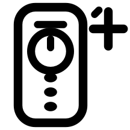
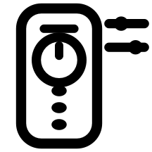

# DialPilot

**Ulanzi AU05（VibeKey）旋钮控制器的 macOS 伴侣 App**：按前台 App 自动切换按键组、用设备灯显示 coding Agent 的工作状态。设备绑定，不是通用工具。

[English](README.md)（默认文档）

> ⚠️ **个人项目声明**：这是一个个人兴趣项目，**不适用于商业化用途**。作者不对任何商业使用提供支持、担保或授权意图。代码以 MIT 许可发布（尊重上游 fork 的许可义务，见 [LICENSE](LICENSE) 与 [NOTICE](NOTICE)），但作者明确表达非商业立场；若你打算商用，请先自行评估法律与商标风险，并联系上游权利人。本软件与 Ulanzi 官方无关，未获其背书。

<p align="center">
  
  
</p>

## 支持的设备

| | |
| --- | --- |
| 厂商 | **Ulanzi**（优篮子 / 乌兰子） |
| 型号 | **AU05**，商品名 **VibeKey** |
| 类型 | USB HID 旋钮控制器：旋钮 + 三按键 + 语音键，4 颗指示灯 |
| USB 标识 | VID `0xFFF1`，PID `0x00DD` |
| 官方宿主 | Ulanzi Studio（DialPilot 不需要它；使用前请退出） |

搜索关键词：`Ulanzi AU05` · `VibeKey` · `优篮子 AU05` · `AU05 旋钮` · `VibeKey macOS` · `Ulanzi 旋钮控制器` · `coding agent 状态灯`

## 功能

- **两组完整六键设置**（AI / 系统），旋钮单按、双按、左右旋、上中下键全部可自定义；支持录制实体键盘组合键（最多四键，区分左右修饰键）。
- **按前台 App 自动切组**：config.json 里配 `appProfileMapping`（bundleID → 组），200ms 防抖，未命中的 App 保持当前组。
- **Agent 状态灯**：旋钮是 Agent 心跳，中键是完成铃，中+下快闪是"回来审批"。支持 Claude Code / Qwen Code / Qoder / CodeBuddy(WorkBuddy) / Codex / DeepSeek Harness / 千问办公（企业版）。
- **多会话仲裁**：多个 Agent 同时跑时灯只显示最高优先级状态（需审批 > 出错 > 压缩 > 思考 > 干活 > 完成 > 空闲），120 秒无事件的会话自动剔除。
- **面板内灯效预览**：下拉选状态直接在设备上看灯效，不用终端。
- 电量 / 充电 / 待机 / 关机时间只读显示；「写入设备」才更新机内六键，平时切组不写设备。
- 零第三方依赖，不联网（QwenWork 监听仅 127.0.0.1 回环），不含任何厂商二进制。

## 状态灯语义

| 状态 | 灯效 | 含义 |
| --- | --- | --- |
| idle / sleeping | 全灭 | 空闲 |
| thinking | 旋钮慢闪 1.2s | 思考中 |
| working | 旋钮常亮 | 干活中 |
| attention | 中键亮 10s 自动灭 | 回合完成 |
| notification | 中+下快闪 0.6s | **需要你审批**（最高优先） |
| error | 全灯闪 3 次→恢复前态 | 出错 |
| sweeping | 三灯流水 0.5s | 压缩上下文 |

语音键灯不参与状态显示（固件按键反馈，按下松开闪一下属正常）。

## 安装

需求：Apple Silicon Mac、macOS 13+、Xcode Command Line Tools。

```sh
git clone https://github.com/lichengwu/dialpilot.git
cd dialpilot
swift test --disable-sandbox        # 224 个测试应全绿（Core 219 + App 5）
./build-app.sh                      # 产物 .build/app/DialPilot.app
```

**签名很重要**：默认 ad-hoc 签名会让 macOS 的输入监控/辅助使用授权在每次重编后失效。用同一张有效开发证书：

```sh
DIALPILOT_SIGNING_IDENTITY="Apple Development: Your Name (TEAMID)" ./build-app.sh
```

然后：
1. 完全退出 Ulanzi Studio（两个宿主会抢设备）。
2. 把 `DialPilot.app` 复制到 `/Applications/` 并启动。
3. 系统设置 → 隐私与安全性 → 允许「输入监控」和「辅助使用」。
4. 首次启动会自动迁移旧版 VibeKey Lite 的配置（若有）。

## 使用

菜单栏图标点开面板：
- **按键组**：AI / 系统切换；每个控制一个下拉，可选预设动作或「录制键盘按键…」。
- **状态灯**：实时状态 chip + 预览下拉 + 「接入 Agent…」按钮。
- **写入设备**：把当前组六个单按写进 AU05 离线存储（App 退出后设备用这一组）。
- **原生模式 / 手势模式**：原生 = 设备直接用机内六键；手势 = App 接管，支持双按/长按。

### 接入 Agent 灯效

面板「接入 Agent…」打开列表：每行显示检测状态，点「接入」自动备份原配置、只新增带 `dialpilot` 标记的 hooks；「卸载」只移除标记条目，你已有的 hooks 原样保留。**未检测到软件会提示先安装，绝不写配置。**

CLI（App 内 `Contents/MacOS/dialpilotctl`）：

```sh
dialpilotctl detect                          # 各 Agent 安装/接入状态
dialpilotctl install-hooks --agent qoder     # claude-code|qwen-code|qoder|codebuddy|codex|dsh
dialpilotctl uninstall-hooks --agent qoder
dialpilotctl led --state working             # 手动设状态（测试）
dialpilotctl led --restore                   # 恢复出厂灯效基线
dialpilotctl status
```

注意：Codex 需在会话内 `/hooks` 批准后才生效；DSH 需重启；千问办公仅企业旗舰版支持（HTTP hooks，App 内复制配置到企业后台粘贴）。

### 自动切组配置

`~/Library/Application Support/DialPilot/config.json`：

```json
{
  "appProfileMapping": {
    "com.apple.Terminal": "a",
    "com.microsoft.VSCode": "a"
  }
}
```

`"a"`=AI 组，`"b"`=系统组；未映射的 App 保持当前组。查 bundleID：`mdls -name kMDItemCFBundleIdentifier -raw /Applications/某App.app`。全字段说明见 [docs/user-guide.md](docs/user-guide.md)。

## 验收

```sh
./scripts/acceptance.sh offline   # 离线：全部自动断言（mock 设备）
./scripts/acceptance.sh live      # 真机：逐状态保持 + 人工核对项暂停
```

## 架构

```
Agent hooks → dialpilotctl → Unix socket → DialPilot App（唯一 HID 写入者）
                                              ├─ DialLedSessionAggregator（多会话仲裁）
                                              ├─ DialLedRenderEngine（纯逻辑渲染状态机，注入时钟可测）
                                              └─ LedRenderer 薄壳（定时器 + HID 写入管道）
```

- `DialPilotCore`：纯逻辑，无 AppKit/IOKit——协议编解码、灯效引擎、安装器、仲裁，全部可单测。
- `DialPilotApp`：菜单栏 App，HID 传输与 UI 薄壳。
- `dialpilotctl`：hook CLI，只发指令不碰 HID（单写者纪律）。

踩坑笔记直接写在对应源码头部（`DialLedControl.swift`、`DialPacketCodec.swift`、`DialHookInstaller.swift` 等），协议细节见 [docs/protocol.md](docs/protocol.md)，灯效设计见 [docs/led-design.md](docs/led-design.md)。

## 来源与致谢

DialPilot 站在这些项目的肩膀上：

- **[arumwu/vibekey-lite](https://github.com/arumwu/vibekey-lite)**（MIT）——本项目的直接前身。fork 后完成了可靠性合并、自动切组、Agent 灯效全链路，再整体重构为 DialPilot。感谢原作者开源了 AU05 的轻量配置器基础。
- **Ulanzi Studio 3.3.6 的 `ustudio-cli` hook 源码**（本机随官方 App 分发的明文 JS）——Agent 事件→状态映射表（9 种 Agent）直接参考了它的 `mappings.js`；安装器契约（settings.json hooks 分组、stdin JSON）也以其为对照。感谢官方把这部分做成了可读的明文。
- **Ulanzi AU05 / VibeKey 硬件**——协议事实来自对一台真实 AU05 的 HID 描述符读取、只读静态分析（Ulanzi Studio 3.3.6 的 `UlanziDeck` 可执行文件）与受控真机读写测试。**本项目不包含、不复制、不加载、不链接、不再分发 `kwdm.dylib`、`UlanziDeck` 或任何厂商二进制**；逆向仅以互操作为目的。逐条结论与置信度标注见 [docs/protocol.md](docs/protocol.md)。
- 各 coding Agent 的公开 hooks 文档（Claude Code、Qwen Code、Qoder、Codex、DeepSeek Harness、千问办公）——安装器按各家公开契约实现。

DialPilot 相对前身的增量：全量四灯帧构造与值域校验、注入时钟的纯逻辑渲染引擎（R1–R7 规则全单测）、多会话优先级仲裁、七家 Agent 一键安装/卸载（备份+只增不删+标记卸载）、QwenWork 回环 HTTP 监听、按前台 App 自动切组、面板重设计（状态灯预览/简体中文化/语义化按钮）、224 个测试（Core 219 + App 5）。

## 许可与声明

- 代码：[MIT](LICENSE)。上游版权保留于 [NOTICE](NOTICE)。
- **个人项目，非商业意图**（见顶部声明）。
- 独立非官方实现，与 Ulanzi 无关；不保证固件兼容性，写坏设备风险自担（防砖纪律：只写已验证命令组、值域校验、GET 读回、退出恢复基线）。