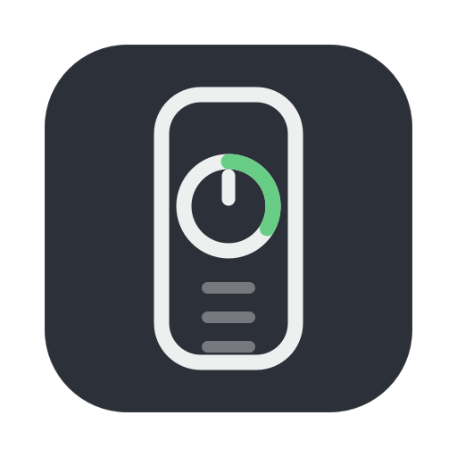
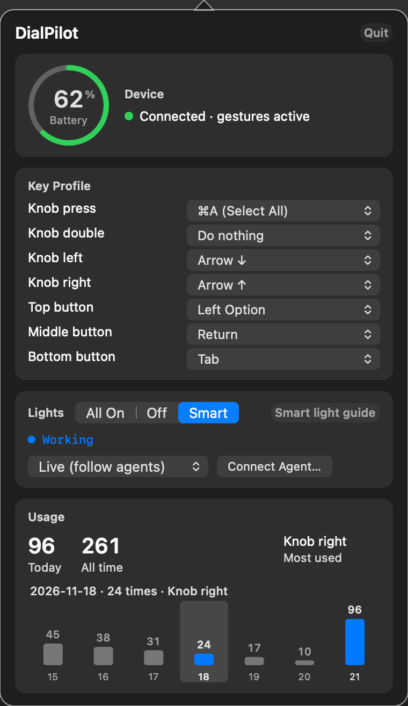
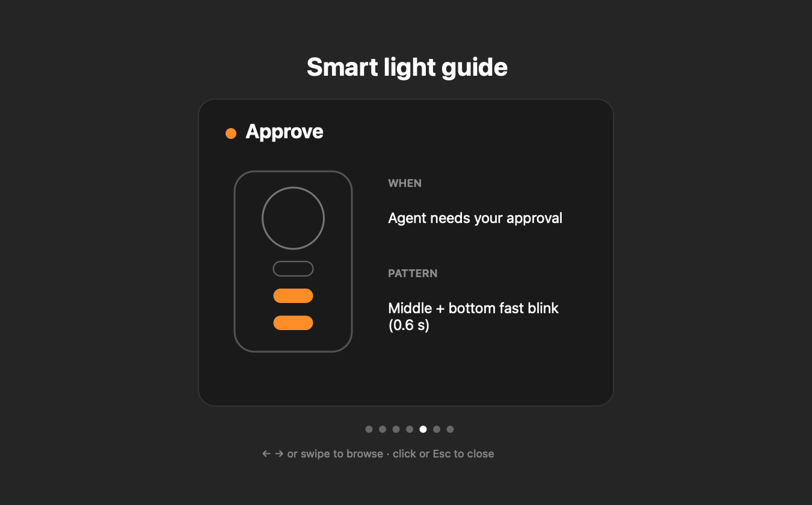

# DialPilot

**Ulanzi AU05（VibeKey）旋钮控制器的 macOS 伴侣 App**：一颗旋钮七个自定义绑定，用设备灯显示 coding Agent 的工作状态。设备绑定，不是通用工具。

[](LICENSE)
[](https://www.apple.com/macos/)
[](https://support.apple.com/en-us/116943)
[](https://swift.org)
[](#安装)
[](Package.swift)

[English](README.md)（默认文档）

> ⚠️ **个人项目声明**：这是一个个人兴趣项目，**不适用于商业化用途**。作者不对任何商业使用提供支持、担保或授权意图。代码以 MIT 许可发布（尊重上游 fork 的许可义务，见 [LICENSE](LICENSE) 与 [NOTICE](NOTICE)），但作者明确表达非商业立场；若你打算商用，请先自行评估法律与商标风险，并联系上游权利人。本软件与 Ulanzi 官方无关，未获其背书。

<p align="center">
  
</p>

## 截图

| 面板 | 统计悬停详情 |
| --- | --- |
|  |  |

| Agent 接入 | 全屏灯效图解 |
| --- | --- |
|  |  |

## 支持的设备

| | |
| --- | --- |
| 厂商 | **Ulanzi**（优篮子 / 乌兰子） |
| 型号 | **AU05**，商品名 **VibeKey** |
| 类型 | USB HID 旋钮控制器：旋钮 + 三按键 + 语音键，4 颗指示灯 |
| USB 标识 | VID `0xFFF1`，PID `0x00DD` |
| 官方宿主 | Ulanzi Studio（DialPilot 不需要它；使用前请退出） |

搜索关键词：`Ulanzi AU05` · `VibeKey` · `优篮子 AU05` · `AU05 旋钮` · `VibeKey macOS` · `Ulanzi 旋钮控制器` · `coding agent 状态灯`

## 功能

- **一颗旋钮，七个绑定**：旋钮单按、双按、左右旋、上中下键全部可自定义；支持录制实体键盘组合键（最多四键，区分左右修饰键）。
- **Agent 状态灯**：旋钮是 Agent 心跳，中键是完成铃，中+下快闪是"回来审批"。支持 Claude Code / Qwen Code / Qoder / CodeBuddy(WorkBuddy) / Codex / DeepSeek Harness / 千问办公（企业版）。
- **多会话仲裁**：多个 Agent 同时跑时灯只显示最高优先级状态（需审批 > 出错 > 压缩 > 思考 > 干活 > 完成 > 空闲），120 秒无事件的会话自动剔除。面板显示当前亮灯的是哪个 Agent/会话，悬停列出全部活跃会话；`dialpilotctl status` 打印同样明细。
- **三种灯效模式**：全开 / 关闭（与设备原生全局模式一致）+ 智能（随 Agent 事件）。全屏图解（←/→ 或滑动浏览，点击/Esc 关闭）说明每种智能灯效何时亮、怎么亮。
- **面板内灯效预览**：下拉选状态直接在设备上看灯效，不用终端。
- **设备备份零维护**：改一个绑定，AU05 机内六键自动跟着更新（防抖合并）。没有写入按钮、不用确认——App 退出后按键照样能用。
- **双语界面**：英文 / 简体中文，自动跟随系统语言。
- **菜单栏只报异常**：一切就绪时图标干净无徽章；红点=电量低、绿点=充电中、橙点=缺权限、淡化虚线=设备不在或已关机。同一时刻只亮一个，按固定优先级。
- **不怕菜单栏管理工具**：面板是自己定位的窗口，不是 `NSPopover`。Bartender / Ice 挪动或隐藏图标时，面板跟着图标的实时位置走；图标彻底消失就自动关闭，不会再弹出一大片空白。
- **诚实的连接状态**：关机的 AU05 仍挂在 USB 上、心跳也照回，所以"设备在"不等于"设备能用"。电源查询连续无应答时，面板显示「未响应」，而不是继续展示关机前的旧电量。
- **电量环形仪表**：面板用圆环+大数字显示电量（绿 ≥50%/充电，黄 20–49%，红 <20%）。
- **本地使用统计**：今日/累计次数、最常用控制、7 天柱状图（每根柱子带数值，悬停看完整日期和当天最常用控制）。只存在 `~/Library/Application Support/DialPilot/usage.json`——不联网，除控制名和日期外无任何标识。
- 开机自启默认开启。
- 零第三方依赖，不联网（QwenWork 监听仅 127.0.0.1 回环），不含任何厂商二进制。

## 状态灯语义

| 状态 | 灯效 | 含义 |
| --- | --- | --- |
| idle / sleeping | 全灭 | 空闲 |
| thinking | 旋钮慢闪 1.2s | 思考中 |
| working | 旋钮常亮 | 干活中 |
| attention | 中键亮 10s 自动灭 | 回合完成 |
| notification | 中+下快闪 0.6s | **需要你审批**（最高优先） |
| error | 全灯闪 3 次→恢复前态 | 出错 |
| sweeping | 三灯流水 0.5s | 压缩上下文 |

语音键灯不参与状态显示（固件按键反馈，按下松开闪一下属正常）。

## 需要的系统权限

手势与 Agent 灯效需要两项 macOS 权限。**不授权时设备原生六键仍可用**——不会坏，只是没有双按和灯效控制。

| 权限 | 为什么需要 | 在哪授权 |
| --- | --- | --- |
| **输入监控** | 通过 HID 读取 AU05 的旋钮/按键事件（自定义控制接口） | 系统设置 → 隐私与安全性 → 输入监控 → 允许 DialPilot |
| **辅助使用** | 把配置的键盘动作（合成按键事件）发给前台 App | 系统设置 → 隐私与安全性 → 辅助使用 → 允许 DialPilot |

- 任一权限缺失时，面板会显示**权限横幅 + 一键授权按钮**；按钮直达对应设置面板（macOS 支持时同时触发系统弹窗）。
- 授权后重新打开面板即可——每次打开都会重新检测。输入监控授权有时需要重启 App 才生效；若手势仍未启用，退出并重新打开 DialPilot。
- **签名影响权限**：macOS 把 TCC 授权绑定到代码签名。换证书（或 ad-hoc）重编会使授权失效，需重新允许。每次构建用同一张有效开发证书（见下方安装）。
- 不申请其他权限：不联网（可选的 QwenWork 监听仅绑 127.0.0.1）、不用摄像头/麦克风、不读写 `~/Library/Application Support/DialPilot` 与你明确接入的 Agent 配置之外的文件。

## 首次使用前（一次性，用 Ulanzi Studio 完成）

DialPilot 直接通过 HID 与设备通信，**不需要 Ulanzi Studio 运行**。但全新 AU05 第一次使用前，先在官方 App 里做一次：

1. **安装 Ulanzi Studio**（官网下载），USB 连接 AU05。
2. **升级固件**（如果 Studio 提示有更新）。DialPilot 从不碰固件——它只写已验证的灯控组和六格按键。固件升级必须走官方 App。
3. **确认设备原生可用**：旋钮旋转和三个按键在 Studio 里能产生出厂动作。这一步验证硬件，也给你一个已知正常的基线。
4. **完全退出 Ulanzi Studio**（⌘Q——关窗口不算，检查菜单栏/Dock）。之后保持它关闭。

DialPilot 不需要你在 Studio 里做账号绑定或按键映射——首次启动它会自动写入自己的六格备份。

### 保持 Ulanzi Studio 关闭

两个宿主不能同时驱动 AU05。DialPilot 的防御性处理：

- **启动时**：Studio 在运行，DialPilot 不接管设备并提示你；原生六键照常可用。
- **写入设备时**：Studio 在运行，DialPilot 会代你退出它（先礼后兵：优雅退出，4 秒不退再强制），然后才写入；两者都失败会警告。
- **运行中 Studio 被打开**：DialPilot 立即把设备交还原生模式并恢复灯光基线；Studio 退出后自动重连。

建议：把 Studio 从登录项里移除，避免它和 DialPilot 一起自启。

## 安装

**Homebrew：一条命令，没有 Gatekeeper 弹窗**

```sh
brew install --cask lichengwu/tap/dialpilot
```

cask 锁死了发布映像的 SHA-256，装完顺手清掉隔离标记，所以第一次双击就能开，`brew upgrade` 可持续升级。

**脚本安装：不用 Homebrew 的人**

```sh
curl -fsSL https://raw.githubusercontent.com/lichengwu/dialpilot/main/scripts/install.sh | sh
```

自动解析最新版本、用发布页的 SHA-256 校验映像、装到 `/Applications`、清除隔离标记。

**磁盘映像：手动路径**
从 [Releases](https://github.com/lichengwu/dialpilot/releases/latest) 下载 `DialPilot-<version>.dmg`，打开后把 **DialPilot** 拖到 Applications 快捷方式上。浏览器下载的文件带隔离标记，Gatekeeper 会拦第一次启动。**右键 → 打开这个办法已经失效**——Apple 在 macOS 15 Sequoia 移除了该绕过方式，macOS 26 同样如此。正确做法：

1. 先双击 App 一次，看到警告后点「完成」。
2. 系统设置 → 隐私与安全性 → 滚到「安全性」区块 → **仍要打开**。
3. 认证后警告会再弹一次，这次带「打开」按钮。

「仍要打开」只在被拦那次启动后约一小时内出现——找不到就再双击一次 App，然后立刻回系统设置。终端等价命令：`xattr -dr com.apple.quarantine /Applications/DialPilot.app`。

**签名说明（不粉饰）**：发布映像用 **ad-hoc 签名**，没有 Apple 证书、**未公证**。这是刻意的：Apple Development 签名对下载者毫无帮助（照样被 Gatekeeper 拦），还会在证书过期后连带旧版本一起失效。要做到双击直开，必须有 Developer ID 证书 + 公证，那需要付费加入 Apple Developer Program（¥688/年），本项目没有。Homebrew 与脚本两条通道之所以不弹窗，是因为文件由它们自己下载，不带浏览器的隔离标记。

然后：
1. 完全退出 Ulanzi Studio（两个宿主会抢设备）。
2. 系统设置 → 隐私与安全性 → 允许「输入监控」和「辅助使用」。
3. 首次启动会自动迁移旧版 VibeKey Lite 的配置（若有）。

需求：Apple Silicon Mac、macOS 13+。

### 从源码构建

需求：Apple Silicon Mac、macOS 13+、Xcode Command Line Tools。

```sh
git clone https://github.com/lichengwu/dialpilot.git
cd dialpilot
swift test --disable-sandbox        # 271 个测试应全绿（Core 247 + App 24）
./build-app.sh                      # 产物 .build/app/DialPilot.app
./scripts/make-dmg.sh               # 产物 dist/DialPilot-<version>.dmg + .sha256
```

**签名很重要，而且两种构建刻意不同**：macOS 把输入监控/辅助使用授权绑定到代码签名，ad-hoc 签名每次重编都换身份，会悄悄让你刚给的授权失效。所以：

- `build-app.sh`（给你自己装的那份）自动挑本机第一张 **Apple Development** 证书，让授权跨重编稳定。要指定：`DIALPILOT_SIGNING_IDENTITY="Apple Development: …"`。
- `make-dmg.sh`（给别人下载的那份）只对**暂存副本**重签成 **ad-hoc**，不碰 `.build/app`。ad-hoc 不会过期，旧版本永远能开；将来有 Developer ID 时用 `DIALPILOT_RELEASE_IDENTITY="Developer ID Application: …"` 替换。

发布后跑 `./scripts/update-cask.sh` 把新版本号与 SHA-256 写进 Homebrew cask。

## 使用

菜单栏图标点开面板：
- **按键**：每个控制一个下拉，可选预设动作或「录制键盘按键…」。改完自动保存并同步到设备。
- **灯效**：全开 / 关闭 / 智能模式切换、实时状态 chip、预览下拉、「接入 Agent…」按钮，以及打开全屏灯效图解的按钮。
- **使用统计**：今日/累计次数、最常用控制、7 天柱状图。第一次使用前整卡隐藏；悬停柱子看完整日期、当天次数和最常用控制。
- **退出**：唯一的维护按钮。其余（设备备份、开机自启、手势模式）全自动。

面板按 Esc、点面板外任意位置、或 ⌘-Tab 都会关闭；菜单栏重排时面板跟着走，状态项消失时直接关闭，不会悬在半空。

### 接入 Agent 灯效

面板「接入 Agent…」打开列表：每行显示检测状态，点「接入」自动备份原配置、只新增带 `dialpilot` 标记的 hooks；「卸载」只移除标记条目，你已有的 hooks 原样保留。**未检测到软件会提示先安装，绝不写配置。**

CLI（App 内 `Contents/MacOS/dialpilotctl`）：

```sh
dialpilotctl detect                          # 各 Agent 安装/接入状态
dialpilotctl install-hooks --agent qoder     # claude-code|qwen-code|qoder|codebuddy|codex|dsh
dialpilotctl uninstall-hooks --agent qoder
dialpilotctl led --state working             # 手动设状态（测试）
dialpilotctl led --restore                   # 恢复出厂灯效基线
dialpilotctl status                          # 灯效状态 + 活跃会话明细（* 标记亮灯者）
```

注意：Codex 需在会话内 `/hooks` 批准后才生效；DSH 需重启；千问办公仅企业旗舰版支持（HTTP hooks，App 内复制配置到企业后台粘贴）。

## 验收

```sh
./scripts/acceptance.sh offline   # 离线：全部自动断言（mock 设备）
./scripts/acceptance.sh live      # 真机：逐状态保持 + 人工核对项暂停
```

## 架构

```
Agent hooks → dialpilotctl → Unix socket → DialPilot App（唯一 HID 写入者）
                                              ├─ DialLedSessionAggregator（多会话仲裁）
                                              ├─ DialLedRenderEngine（纯逻辑渲染状态机，注入时钟可测）
                                              └─ LedRenderer 薄壳（定时器 + HID 写入管道）
```

- `DialPilotCore`：纯逻辑，无 AppKit/IOKit——协议编解码、灯效引擎、安装器、仲裁、存活判定、使用统计、本地化，全部可单测。
- `DialPilotApp`：菜单栏 App，HID 传输与 UI。面板是 `DialPanelController` 持有的无边框 `NSPanel`，窗口几何由纯函数 `DialPanelGeometry` 计算并被单测覆盖，`NSPopover` 那类尺寸/位置 bug 从结构上回不来。
- `dialpilotctl`：hook CLI，只发指令不碰 HID（单写者纪律）。

踩坑笔记直接写在对应源码头部（`DialLedControl.swift`、`DialPacketCodec.swift`、`DialHookInstaller.swift`、`DialPanelController.swift` 等）。

## 文档

| 文档 | 语言 | 内容 |
| --- | --- | --- |
| [用户指南](docs/user-guide.md) | 中文 | 安装、面板说明、权限、Agent 接入、排障（维护主版本） |
| [User guide](docs/user-guide.en.md) | English | 同上（英文版） |
| [协议笔记](docs/protocol.md) | 中文 | HID 报文布局、已验证命令组、置信度标注 |
| [灯效设计](docs/led-design.md) | 中文 | 状态 → 灯效规则（R1–R7）与仲裁 |
| [更新日志](CHANGELOG.zh.md) | 中文 | 版本变更（Keep a Changelog） |

## 来源与致谢

DialPilot 站在这些项目的肩膀上：

- **[arumwu/vibekey-lite](https://github.com/arumwu/vibekey-lite)**（MIT）——本项目的直接前身。fork 后完成了可靠性合并、Agent 灯效全链路，再整体重构为 DialPilot。感谢原作者开源了 AU05 的轻量配置器基础。
- **Ulanzi Studio 3.3.6 的 `ustudio-cli` hook 源码**（本机随官方 App 分发的明文 JS）——Agent 事件→状态映射表（9 种 Agent）直接参考了它的 `mappings.js`；安装器契约（settings.json hooks 分组、stdin JSON）也以其为对照。感谢官方把这部分做成了可读的明文。
- **Ulanzi AU05 / VibeKey 硬件**——协议事实来自对一台真实 AU05 的 HID 描述符读取、只读静态分析（Ulanzi Studio 3.3.6 的 `UlanziDeck` 可执行文件）与受控真机读写测试。**本项目不包含、不复制、不加载、不链接、不再分发 `kwdm.dylib`、`UlanziDeck` 或任何厂商二进制**；逆向仅以互操作为目的。逐条结论与置信度标注见 [docs/protocol.md](docs/protocol.md)。
- 各 coding Agent 的公开 hooks 文档（Claude Code、Qwen Code、Qoder、Codex、DeepSeek Harness、千问办公）——安装器按各家公开契约实现。

DialPilot 相对前身的增量：全量四灯帧构造与值域校验、注入时钟的纯逻辑渲染引擎（R1–R7 规则全单测）、多会话优先级仲裁、七家 Agent 一键安装/卸载（备份+只增不删+标记卸载）、QwenWork 回环 HTTP 监听、零维护单组面板（设备自动备份、全屏灯效图解、双语界面、菜单栏异常徽章、电量环形仪表、本地使用统计、不怕菜单栏管理工具的自定位面板）、271 个测试（Core 247 + App 24）。

## 许可与声明

- 代码：[MIT](LICENSE)。上游版权保留于 [NOTICE](NOTICE)。
- **个人项目，非商业意图**（见顶部声明）。
- 独立非官方实现，与 Ulanzi 无关；不保证固件兼容性，写坏设备风险自担（防砖纪律：只写已验证命令组、值域校验、GET 读回、退出恢复基线）。